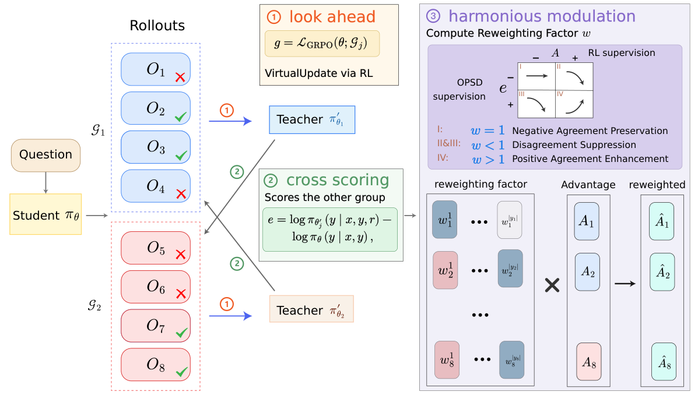

# Teach Me After You Learn It: Lookahead Self-Distillation for RLVR

[](http://arxiv.org/abs/2610.18256)

## Overview

**LEAD** (LookahEAd self-Distillation) lets a teacher learn from other on-policy rollouts through virtual RL updates before teaching the student. It uses cross-group token-level supervision and harmonious modulation to combine self-distillation with RLVR. See the [paper](http://arxiv.org/abs/2610.18256) for details.




## Installation

Use a Linux machine with eight CUDA GPUs and a compatible PyTorch, CUDA, vLLM, and FlashAttention environment. Our local run used Python 3.12.13, PyTorch 2.9.0+cu128, vLLM 0.12.0, and eight H800 GPUs.

```bash
git clone https://github.com/zzp-seeker/LEAD.git
cd LEAD
python -m pip install -r code/sci/framework/requirements.txt
python -m pip install -e 'code/sci/framework[vllm]'
```

Install a FlashAttention build compatible with your PyTorch and CUDA versions.

## Training

The scientific-reasoning data are included in `data/`. Download a Qwen3-4B checkpoint, then run from the repository root:

```bash
export MODEL_PATH=/path/to/Qwen3-4B
export DATA_DIR="$PWD/data"
export CKPT_DIR="$PWD/outputs/lead_biology_qwen3-4b"
bash code/sci/scripts/run_train.sh lead biology qwen3-4b
```

`MODEL_PATH` must contain `config.json`. Checkpoints and rollout traces are written under `CKPT_DIR`. For other runs, change the method (`grpo`, `sdpo`, `rlsd`, `lead`), domain (`biology`, `chemistry`, `material`, `physics`), and scale (`qwen3-4b`, `qwen3-8b`) in the last command. Use the matching checkpoint and a fresh `code/sci/framework` copy when switching methods.

The interactive-agent training framework is included under `code/agent/framework/`. Prepare the ALFWorld, WebShop, or Search task data and environment dependencies separately. WebShop browser mode also needs a local ChromeDriver. Use a separate Python environment for these experiments:

```bash
python -m pip install -e 'code/agent/framework[vllm]'
export MODEL_PATH=/path/to/Qwen3-4B
export AGENT_DATA_DIR=/path/to/agent-data
export CKPT_DIR="$PWD/outputs/lead_webshop_qwen3-4b"
bash code/agent/scripts/run_train.sh lead webshop qwen3-4b
```

## Citation

```bibtex
@article{zhai2026lead,
  title={Teach Me After You Learn It: Lookahead Self-Distillation for RLVR},
  author={Zhai, Zepeng and Chen, Meilin},
  journal={arXiv preprint arXiv:2610.18256},
  year={2026}
}
```
